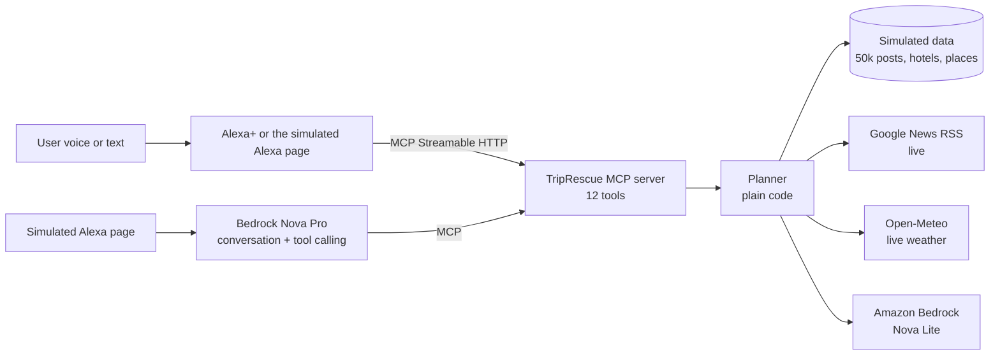

# TripRescue

**An Alexa+ MCP server that tells you if a trip is worth taking right now, plans it around you, and fixes it when things go wrong.**

Most trip assistants only plan. TripRescue also reads what travellers and the news are saying about a destination, gives a GO / WAIT / SKIP verdict with its reasons, and replans the trip when rain or a closure breaks it. It always leaves the decision to you.

- **Live demo:** https://xlx2hpg32sdp7eimjztlbo7wly0utsnw.lambda-url.ap-southeast-2.on.aws
- **MCP endpoint:** `https://xlx2hpg32sdp7eimjztlbo7wly0utsnw.lambda-url.ap-southeast-2.on.aws/mcp` (Streamable HTTP, protocol 2025-11-25)
- **Track:** Alexa+ (self-hosted MCP server). **Mini challenge:** AWS Builder (Amazon Bedrock on AWS Lambda).

## A conversation with it

> **You:** Plan 5 days in Goa from 10 December.
> **Alexa:** Started your trip for two with a ₹60,000 budget. Your cousin's wedding is on day 3, so I'll keep that evening free. Shall I build the itinerary?
>
> **You:** Is it worth going?
> **Alexa:** My verdict is skip, 73% confident. 159 recent posts report flooding, mostly around Dudhsagar, and today's news has a high wave warning for Goa. Gokarna has similar beaches with far fewer problems. Do you still want Goa, or should I check Gokarna?
>
> **You:** Will rain affect my plan?
> **Alexa:** Heavy rain is forecast on days 4 and 5, which hits four outdoor activities. Want me to swap them for indoor ones?
>
> **You:** Yes.
> **Alexa:** Done. Cooking class and cafes instead of water sports, and it saves ₹2,500.

## How it works



- **Planning logic is plain code.** Budgets, hotel ranking, itineraries and replans are deterministic and fast (most tools answer in under 40 ms).
- **The verdict is a two-stage analysis.**
  1. A keyword pass scores every relevant post across the full 50,018-post dataset plus live news in about 20 ms. Each post is weighted by recency, likes, source trust (reviews count more than casual posts), and whether it mentions a place in your itinerary.
  2. Amazon Bedrock (Nova Lite) re-reads the 12 highest-weighted posts, and its judgement replaces the keyword score for those posts.
- **Every tool returns a short `speech` field** written for voice, plus structured data.
- **The user decides.** The verdict never changes the trip on its own. Bookings and plan changes need an explicit yes, which is enforced in code, not only in the prompt.

## The 12 MCP tools

| Tool | What it does |
|---|---|
| `start_trip_planning` | Starts a trip (destination, dates, budget, travellers) and checks the calendar |
| `get_user_profile` | Likes, dislikes, budget and past trips |
| `update_preferences` | Remembers "I love scuba" or "no crowds" |
| `check_calendar` | Finds busy days during the trip |
| `search_hotels` | Ranks hotels by what you like, within budget |
| `build_itinerary` | Day-by-day plan that skips what you dislike and keeps busy days light |
| `budget_breakdown` | Hotel, activities and food against your budget |
| `trip_verdict` | GO / WAIT / SKIP from social posts and live news, with confidence, evidence, affected plan items and a safer alternative |
| `check_disruption` | Forecast check: which outdoor plans rain would break |
| `replan_trip` | Swaps affected activities for indoor ones you'll like. Waits for confirmation |
| `explain_changes` | Says what changed and why |
| `confirm_booking` | Applies changes or books (simulated). Only with `confirm: true` |

Clients that send an `x-session-id` header get their own trip. Without it, requests share one default trip.

## What is real and what is simulated

| Data | Source |
|---|---|
| News headlines | **Live** from Google News RSS, cached 10 minutes |
| Weather | **Live** from Open-Meteo for trips within about 16 days; a saved forecast for later dates |
| Social posts | Simulated: 50,018 posts across 25 Indian destinations, generated by `scripts/generate-data.js` with a fixed seed, plus 18 hand-written demo posts |
| Hotels, activities, profile, calendar | Simulated JSON in `data/` |
| Bookings | Simulated |

Real social platforms (Instagram, X) have no free search API, so the post feed is simulated at production scale to show the analysis working on realistic volume. The `scenario` option (`monsoon` or `normal`) picks which simulated feed to use. The live demo uses `monsoon`.

## Amazon Bedrock integration (AWS Builder)

| Use | Model | Where |
|---|---|---|
| Deep read of the top 12 posts: sentiment and topic | `amazon.nova-lite-v1:0` | `bedrock.js` `deepReadPosts()` |
| Rewording the verdict for voice | `amazon.nova-lite-v1:0` | `bedrock.js` `speak()` |
| The simulated Alexa: conversation and tool calling over MCP | `amazon.nova-pro-v1:0` | `chat.js`, `bedrock.js` `converseRaw()` |

- All calls use the Bedrock **Converse API** in `ap-southeast-2` (Sydney).
- Locally, the app authenticates with a Bedrock API key in `.env`. On Lambda it uses the function's IAM role, so no key is deployed.
- **Fallbacks:** if Bedrock fails or takes longer than 4 seconds, the verdict keeps the keyword result and plain wording. The response says which was used (`analysis`, `wording`).
- **Hosting:** the server runs on **AWS Lambda** behind a Function URL (`lambda.js`, using `serverless-http`). The chat page is rate limited to 12 messages per minute per visitor so a public URL cannot run up the Bedrock bill.

## Run it locally

Requires Node.js 22 or later.

```bash
git clone https://github.com/QuantaBoy/Trip-Rescue-MCP.git
cd Trip-Rescue-MCP
npm install
npm start          # MCP server at http://localhost:3000/mcp, chat page at http://localhost:3000
```

Bedrock is optional. Without it, the tools work with keyword analysis and plain replies, and the chat page reports that the assistant is offline. To enable it, create `.env`:

```
AWS_BEARER_TOKEN_BEDROCK=your-bedrock-api-key
AWS_REGION=ap-southeast-2
BEDROCK_MODEL=amazon.nova-lite-v1:0
```

**Try it with the MCP Inspector:**

```bash
npx @modelcontextprotocol/inspector
```

Choose Streamable HTTP with `http://localhost:3000/mcp`, then call `start_trip_planning` with `{"destination": "Goa"}`, `build_itinerary`, and `trip_verdict`.

**Tests:**

```bash
npm test           # the full demo story against the planner, plus a live news check and latency check
npm run test:mcp   # starts the server and drives it through a real MCP client, including session isolation
```

### Settings

| Variable | Default | Purpose |
|---|---|---|
| `PORT` | `3000` | Local port |
| `AWS_BEARER_TOKEN_BEDROCK` | none | Bedrock API key (local only) |
| `AWS_REGION` | `ap-southeast-2` | Bedrock region |
| `BEDROCK_MODEL` | `amazon.nova-lite-v1:0` | Model for deep read and wording |
| `CHAT_MODEL` | `amazon.nova-pro-v1:0` | Model for the simulated Alexa |
| `DEMO_SCENARIO` | `monsoon` | Simulated feed the chat page uses (`monsoon` or `normal`) |
| `USE_BEDROCK` | on | Set to `0` to turn Bedrock off |
| `MCP_TOKEN` | none | If set, `/mcp` requires `Authorization: Bearer <token>` |

Tuning for the analysis (time window, weights, thresholds) is in the `CONFIG` object at the top of `planner.js`.

## Deploy to AWS Lambda

1. Build the package with forward-slash paths (Windows' `Compress-Archive` writes backslashes, which Lambda cannot read):
   ```powershell
   tar.exe -a -c -f deploy.zip server.js mcp.js chat.js planner.js sources.js bedrock.js lambda.js package.json data public node_modules
   ```
2. Create a Node.js 22.x function, upload `deploy.zip`, and set the handler to `lambda.handler`.
3. Set memory to 1024 MB and the timeout to 1 minute.
4. Give the execution role `bedrock:InvokeModel`.
5. Create a Function URL with auth type NONE.

## Project layout

```
server.js      Express app: /mcp, /chat, /health, static page
mcp.js         The 12 tools as an MCP server
planner.js     Planning, analysis and replanning logic, CONFIG
sources.js     Live news (Google News RSS) and weather (Open-Meteo) with fallbacks
bedrock.js     Bedrock calls: deep read, voice wording, chat
chat.js        Simulated Alexa: Bedrock agent loop calling the MCP tools
lambda.js      AWS Lambda entry point
public/        The simulated Alexa+ page
data/          Demo data, and data/generated/ for the large dataset
scripts/       Dataset generator
```

## Known limits

- Trips are kept in memory per server instance, so a restart or a second Lambda instance starts fresh. DynamoDB is the planned upgrade.
- The verdict reads posts from the last 72 hours, which describes conditions now rather than on the trip dates.
- The budget does not yet include travel to the destination.
- The verdict takes 2 to 5 seconds because of live news and Bedrock; repeat calls are faster thanks to caching.

## Built during the hackathon

Everything in this repository was built during the Amazon Developer Hackathon submission window. See [FRICTION_LOG.md](FRICTION_LOG.md) and [FEEDBACK.md](FEEDBACK.md) for what we ran into along the way.

## License

MIT. See [LICENSE](LICENSE).
